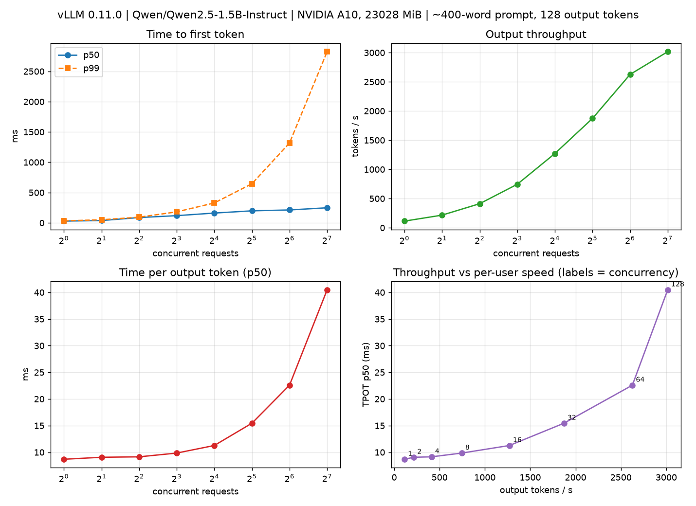

# GPU Inference Lab

Three hands-on studies of LLM inference performance, each run on a cloud GPU through [Modal](https://modal.com):

1. **vLLM under load.** Serve a model with vLLM and measure time-to-first-token (TTFT), time-per-output-token (TPOT) and throughput as concurrent users go from 1 to 128.
2. **Roofline + Nsight.** Measure the GPU's real bandwidth and compute ceilings, place 11 workloads on a roofline (from batch-1 decode GEMV to large GEMMs), and check byte counts with Nsight Compute hardware counters. Also records an Nsight Systems timeline.
3. **Fused RMSNorm in Triton.** A one-pass RMSNorm kernel, tested against PyTorch and benchmarked in GB/s against eager PyTorch, `F.rms_norm` and `torch.compile`.

The three connect: the roofline explains *why* vLLM's throughput rises with concurrency (batching moves decode GEMVs right, out of the memory-bound zone), and the Triton kernel is graded against the same bandwidth roof.

## Results

### 1. vLLM under load

**Qwen2.5-1.5B-Instruct** on an **NVIDIA A10 (24 GB)**, vLLM 0.11.0. Each request has a ~400-word random prompt and generates exactly 128 tokens. Load is closed-loop: each simulated user sends a request, waits for the full streamed answer, then sends the next.



| Concurrency | TTFT p50 (ms) | TTFT p99 (ms) | TPOT p50 (ms) | Output tok/s | Req/s |
|---:|---:|---:|---:|---:|---:|
| 1 | 28.4 | 32.3 | 8.68 | 113 | 0.88 |
| 2 | 38.0 | 51.0 | 9.06 | 216 | 1.68 |
| 4 | 87.4 | 93.3 | 9.14 | 412 | 3.21 |
| 8 | 118.7 | 181.5 | 9.84 | 744 | 5.82 |
| 16 | 161.6 | 328.4 | 11.27 | 1271 | 9.93 |
| 32 | 198.2 | 645.2 | 15.45 | 1872 | 14.63 |
| 64 | 213.0 | 1317.7 | 22.58 | 2626 | 20.52 |
| 128 | 248.8 | 2824.4 | 40.48 | 3016 | 23.56 |

**What the numbers show**

- **Batching is nearly free at low load.** From 1 to 16 users, throughput rises 11x (113 to 1,271 tok/s) while per-token latency rises only 30% (8.7 to 11.3 ms). A decode step reads every weight from memory regardless of batch size, so extra sequences in the batch cost little.
- **Saturation starts around 64 users.** From 64 to 128 users, throughput grows only 15% (2,626 to 3,016 tok/s) while TPOT grows 79% (22.6 to 40.5 ms). Past this point more concurrency mostly slows every user down.
- **Tail TTFT degrades much faster than the median.** At 128 users, TTFT p50 is 249 ms but p99 is 2.8 s, because new prompts wait behind decode work for running requests. Part of the p99 comes from all users starting at the same instant at each level, which is a property of the closed-loop test.
- **Overall:** 27x more throughput at 128 users than at 1, for 4.7x higher per-token latency. The right operating point depends on the latency target; for example, a TTFT p99 budget of 500 ms puts the limit near 16 to 32 users on this GPU.

### 2. Roofline + Nsight

Results pending. Run `modal run roofline/modal_roofline.py`.

### 3. Triton RMSNorm

Results pending. Run `modal run triton_rmsnorm/modal_triton.py`.

## Setup (once)

```bash
pip install modal
modal setup          # opens a browser to log in and saves a token
```

## Run

From the repo root. Each command builds its container image on the first run (a few minutes), then runs on the GPU and writes a `.md` table, a `.png` chart and a `.json` with every number into `results/`.

```bash
modal run triton_rmsnorm/modal_triton.py     # tests, then the benchmark
modal run roofline/modal_roofline.py         # roofline, nsys, ncu
modal run vllm_bench/modal_vllm_bench.py     # downloads the model on the first run
```

Options:

```bash
GPU=H100 modal run roofline/modal_roofline.py                     # any Modal GPU: T4, L4, A10G (default), L40S, A100, H100
modal run vllm_bench/modal_vllm_bench.py --model Qwen/Qwen2.5-0.5B-Instruct --levels 1,4,16,64,256
modal run vllm_bench/modal_vllm_bench.py --max-tokens 512 --prompt-words 1500
```

## How each part works

- **vLLM benchmark** (`vllm_bench/`): `loadgen.py` is an async streaming client that timestamps the send, the first token and the last token of every request. Prompts are random so vLLM's prefix cache cannot make prefill look free, and `ignore_eos` forces every answer to the same length. The server and the load generator run in the same container, so the numbers measure the server and not the network.
- **Roofline** (`roofline/`): `workloads.py` hand-counts FLOPs and bytes for each workload, measures the two roofs (1 GiB copy for bandwidth, 8192^3 fp16 matmul for compute) and times each workload with CUDA events. `modal_roofline.py` then profiles each one with Nsight Compute inside an NVTX range to read real DRAM bytes.
- **Triton RMSNorm** (`triton_rmsnorm/`): one Triton program per row. The row is loaded once, squared and summed in fp32, normalised, scaled and stored once. Tests cover non-power-of-2 widths, non-contiguous rows, fp16 overflow and 3D inputs.

## Layout

```
vllm_bench/      loadgen.py, modal_vllm_bench.py
roofline/        workloads.py, profile_target.py, modal_roofline.py
triton_rmsnorm/  rmsnorm.py, test_rmsnorm.py, bench_rmsnorm.py, modal_triton.py
results/         tables, charts and raw JSON from each run
STUDY.md         plain-language notes on each part
```

## Testing without a GPU

```bash
TRITON_INTERPRET=1 pytest triton_rmsnorm -q   # runs the kernel in Triton's CPU interpreter
python roofline/workloads.py                  # tiny CPU version of the roofline study
```
